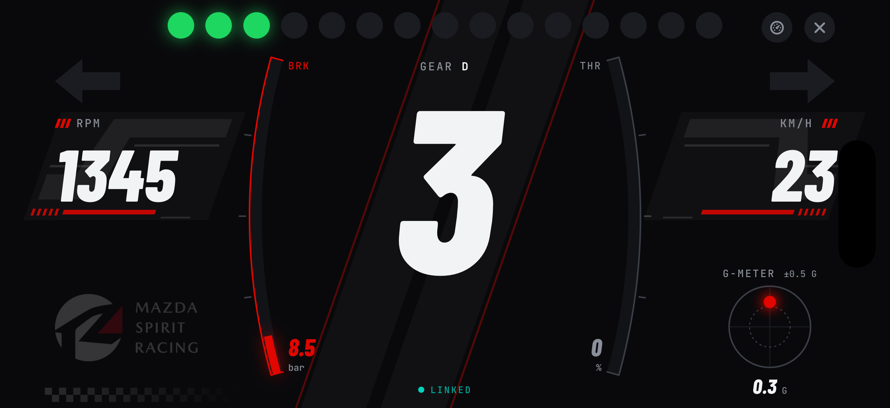
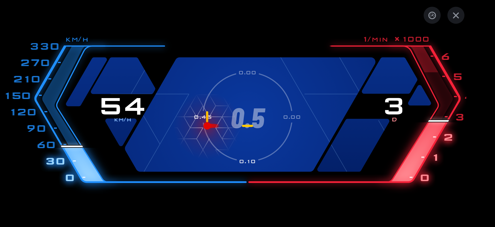

# ESP CAN Companion

An iPhone app for viewing vehicle readings and setting up accessory lighting
over Bluetooth. Choose a lighting preset, adjust it to your liking, and send it
to your accessory controller without editing configuration files.

> **Early development:** The app includes connection, live readings and lighting
> setup features. The LED strip zone editor is still to come. Installation
> currently requires a Mac and Xcode.

## What you can do

- **See what the controller sees.** View readings such as engine speed (RPM),
  road speed and gear, depending on what your controller provides.
- **Set up your accessory lights.** Start with a preset, review how it behaves,
  adjust settings and send it when you're ready.
- **Check what's actually running.** Read the controller's current setup or
  restore its factory lighting settings.

The app has four tabs:

| Tab | Use it for |
| --- | --- |
| **Pit Wall** | Connect to your controller and see an overview of its readings and current setup. |
| **Setup** | Choose and adjust lighting presets, send changes, or restore factory settings. |
| **Drive** | View a landscape dashboard with larger vehicle readouts. |
| **Strip** | LED strip zone editing is planned; this tab is currently a placeholder. |

Missing or out-of-date readings are marked as unavailable rather than shown as
current values.

## Preview / demo

Here's the **Drive** screen in its two dashboard styles. You can switch between
them inside Drive.

### Motorsport

### Bimmer

These are screenshots of the app running in the iPhone Simulator with sample
data. No car or controller was connected; the readings demonstrate the display.

### Video

[Watch the demo on YouTube Shorts](https://youtube.com/shorts/rCT8OWe9huU).

## How the app and controller work together

Your accessory controller reads signals from the car and runs the lighting
rules. CAN Companion connects to that controller to show its readings and change
its setup. The controller handles the lights independently of the phone.

The [Mazda CAN accessory controller](https://github.com/Yuke-hd/mazda-can-accessory-controller)
is the companion hardware project. See that project for the board, wiring,
firmware and hardware validation requirements. Other controllers can work with
the app if their firmware supports the same companion connection.

## What you need

You'll need:

- **An iPhone running iOS 17 or later**, with Bluetooth enabled.
- **A compatible accessory controller**, powered on and running firmware that
  supports CAN Companion. Compatibility depends on the controller, not just
  the car brand.
- **A Mac with Xcode 16 or later** to install this version on your phone.

The app connects to the accessory controller. It cannot connect directly to a
car's built-in Bluetooth or replace the controller hardware.

## Get started

### 1. Install the app

Follow the [iPhone installation guide](docs/development/getting-started.md#install-on-your-own-iphone-development-signing).
It walks through installing with Xcode. If you haven't used Xcode before, you
may want someone familiar with it to help with this step.

You can use a free Apple ID for a personal installation. With a free account,
the app expires after seven days and needs to be installed again through Xcode.

### 2. Connect your controller

1. Power on your accessory controller and keep your iPhone nearby.
2. Open CAN Companion. On **Pit Wall**, tap **Continue** on the Bluetooth card
   and allow Bluetooth access when your iPhone asks.
3. Press the controller's **user key** to allow a new phone to pair. You have
   **two minutes** to complete pairing after pressing it.
4. Select your controller when it appears in the list. If scanning has stopped,
   tap **Find a controller** first. Follow any pairing prompts on your iPhone.
5. Wait for **Linked**. The app then reads the controller's current setup.

The app remembers your controller and attempts to reconnect when it becomes
available again.

### 3. Choose your lighting setup

1. Connect to your controller, then open **Setup**.
2. Choose a preset. Expand **What this setup does** to review it, and adjust
   settings if needed.
3. Tap **Send to car** and confirm the change.
4. Wait for the controller to restart and for the app to confirm the setup is
   **On car**.

Choosing or editing a preset does not change the controller until you send and
confirm it. If the controller rejects a setup, the app shows an error; do not
assume the change was applied. To restore its original lighting setup, use
**Revert to factory** in Setup and confirm.

## Having trouble?

| What you see | What to try |
| --- | --- |
| **Bluetooth off** | Turn on Bluetooth in your iPhone's Settings. |
| **No access** | Tap **Open Settings** and allow Bluetooth access for CAN Companion. |
| No controller appears | Check that the controller is powered on and nearby, then tap **Find a controller** if scanning has stopped. |
| Pairing fails | Press the controller's user key again and retry within two minutes. |
| **Incompatible** | The app and controller firmware do not support the same connection version. Check whether either needs an update. |
| **Relinking** | The app is waiting for the controller to return. Check its power and stay nearby. |

If you need help, [open an issue](https://github.com/Yuke-hd/esp-can-companion/issues)
with what you tried and the message shown in the app. Leave out vehicle
identifiers and personal information.

## Development and documentation

Build commands, iPhone installation, project structure and technical details are
in the [build and development guide](docs/development/getting-started.md).
See the [documentation index](docs/README.md) for architecture and specifications,
and [UI preview and verification](docs/development/ui-verification.md) for testing
screens with a simulated controller.

## License

[MIT](LICENSE).
